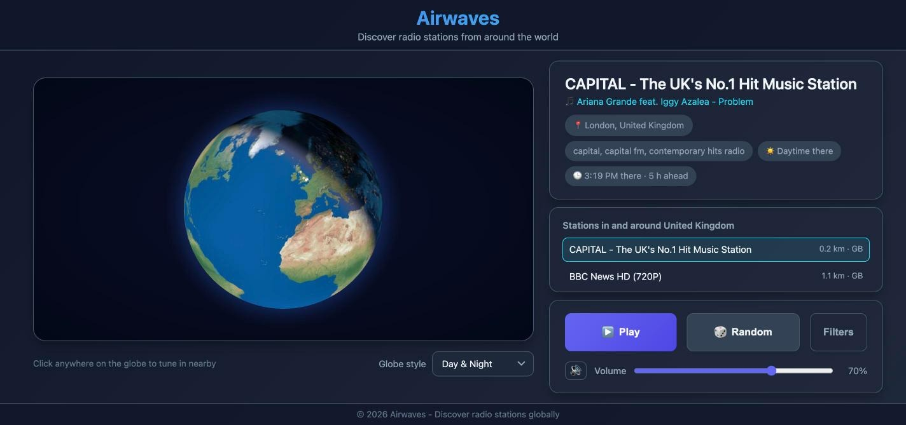
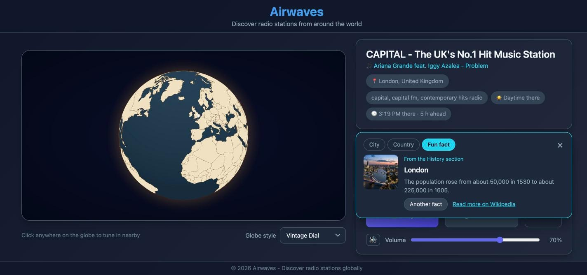
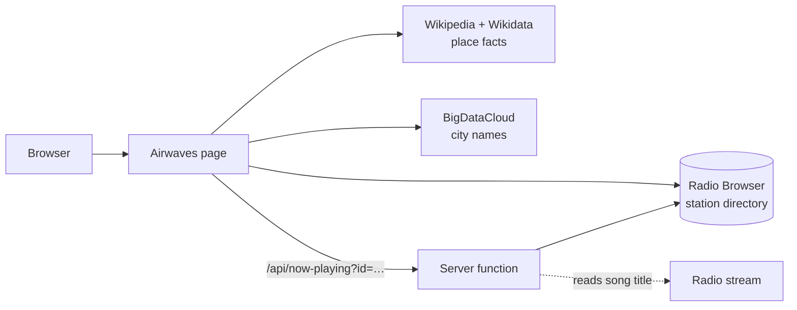

# 📻 Airwaves

Live radio from around the world on a 3D globe. Click anywhere on Earth to hear stations broadcasting there right now, with their local time, whether it's day or night, what song is playing, and a fact about the place.


**Live demo: [airwaves-five.vercel.app](https://airwaves-five.vercel.app)**. Click anywhere on the globe to start listening.



## What it does

- **Click anywhere to tune in.** Airwaves finds stations near the spot you clicked and starts playing the nearest popular one. Zoom in for a tighter search that lists the closest stations first.
- **A real day and night side.** The default globe shows where the sun is right now: daylight on one side, city lights on the other, updated every minute.
- **Local clocks.** Each station shows its local time and how far ahead or behind you it is, with daylight saving handled.
- **Now playing.** For stations that share it, the current song appears under the station name.
- **Place facts.** The place chip opens a card about the city and country, plus a random fun fact from deeper in the Wikipedia article.
- **Random with filters.** Pick a random station by genre, language and continent.
- **Self-healing playback.** If a station doesn't start within 8 seconds, Airwaves moves on to the next one.
- **Two globe styles.** A photo-real "Day & Night" Earth and a "Vintage Dial" map styled like an old radio dial.



## Run it locally

Needs [Node.js](https://nodejs.org) 18 or newer. There's nothing to install. On Vercel the site deploys as-is: `api/now-playing.js` becomes a serverless function automatically.

```bash
git clone https://github.com/TabascoSlim/airwaves.git
cd airwaves
npm run dev        # or: node dev-server.js
```

Then open http://localhost:8080.

Run the tests with:

```bash
npm test
```

## How it fits together



| File | What it does |
|---|---|
| `index.html`, `styles.css` | The page and its layout |
| `app.js` | Searching for stations, playback, the station list, filters, clocks and the fact card |
| `globe-styles.js` | The 3D globe, both styles, the day/night shader and the sun position math |
| `place-facts.js` | City names, Wikipedia summaries, random facts and local musicians |
| `station-filters.js` | Genre, language and continent choices |
| `time-utils.js` | Time zones and "5 h ahead" style differences |
| `country-coordinates.js` | Fallback positions for stations without coordinates |
| `api/now-playing.js` | Server function that reads the current song title from a stream |
| `dev-server.js` | Local server that runs the site and the server function together |
| `tests/` | Automated tests (Node's built-in test runner) |
| `mockups/` | The three globe styles I compared before choosing, with images |

### How "now playing" works

Many internet radio streams hide the song title inside the audio itself, a few kilobytes at a time ("ICY metadata"). Browsers can't read it, so a small server function connects to the stream, reads just far enough to find the title, and disconnects.

It accepts a station ID, never a web address. The function looks up the stream address in the station directory itself and refuses private network addresses. That way nobody can use it to make the server fetch arbitrary pages, a well-known attack called server-side request forgery (SSRF).

## How I built this with AI

I built Airwaves with **Claude** as my coding partner. It started as an unfinished prototype: about 440 lines of JavaScript with a placeholder globe, and it didn't run at all because part of the code sat outside its class. I wanted to turn it into something people would actually enjoy using.

**How we split the work.** I decided what Airwaves should do and how it should feel, and tested every change in the browser. When something felt off, I said so: the cursor felt finicky, the page needed sideways scrolling, the style buttons looked cluttered, the clocks were wordy, a globe style was dropping islands. Claude wrote and debugged most of the code, and we iterated until each piece felt right.

**Real problems we hit and how they got solved:**

1. **"Random" kept playing the same station.** The station directory caches identical requests, so every press got the same saved answer. Each request now carries a unique tag, and the app picks from 10 results while skipping the one already playing.
2. **Clicking Japan showed the same three stations.** Only 3 of Japan's roughly 90 stations list exact coordinates. A click now also looks up which country you clicked and includes every station registered there.
3. **A globe style was missing whole islands.** The dot-grid style dropped narrow islands like Japan. A finer grid brought them back, but other gaps remained, so I cut that style rather than ship a map with holes in it.
4. **The page didn't fit the screen.** The globe's canvas was stretching its grid column past the window. Letting columns shrink (`minmax(0, …)`) fixed the sideways scroll.
5. **The song reader would have crashed every time.** The automated tests caught a variable name used for two different things, before it ever reached a real stream.
6. **Some stations send ads instead of songs.** Titles that are just a web address are now filtered out, and there's a test for it.

**Design changes along the way.** I started by comparing three globe styles side by side ([see the mockups](mockups/)). I asked for a day and night cycle based on where you are. The globe now blends a daytime photo with a city-lights photo using the real position of the sun, and opens facing your part of the world, estimated from your clock's time zone so no location permission is needed. A "Local music" tab became a "Fun fact" tab, because the city summary only explained what the city was.

## Data sources

All free and keyless:

- [Radio Browser](https://www.radio-browser.info): the community station directory
- [Wikipedia](https://en.wikipedia.org) and [Wikidata](https://www.wikidata.org): place summaries, fun facts, local musicians
- [BigDataCloud](https://www.bigdatacloud.com) reverse geocoding: city names from coordinates
- [globe.gl](https://globe.gl), [three-globe](https://github.com/vasturiano/three-globe) Earth textures, [world-atlas](https://github.com/topojson/world-atlas) country shapes, [tz-lookup](https://github.com/darkskyapp/tz-lookup): the globe, maps and time zones

## Honest limits

- **Not every station shares its song.** Talk and news stations usually don't, so the "now playing" line stays hidden for them. In a test of 12 popular music stations, 10 showed the song.
- **Some stations don't list where they are.** Those are placed where you clicked, inside the right country.
- **Wikidata can be slow.** When a town has no article, finding a local musician can take 5 to 10 seconds.
- **Stations come and go.** The directory is community-run, which is why Airwaves skips stations that don't start.

## What's next

- Favourites, listening history and shareable station links
- "Radio roulette": hop to a new random country every few minutes
- Song history per station, with links to find a song on Spotify or YouTube
- A language-learning mode that picks talk stations in the language you're studying
