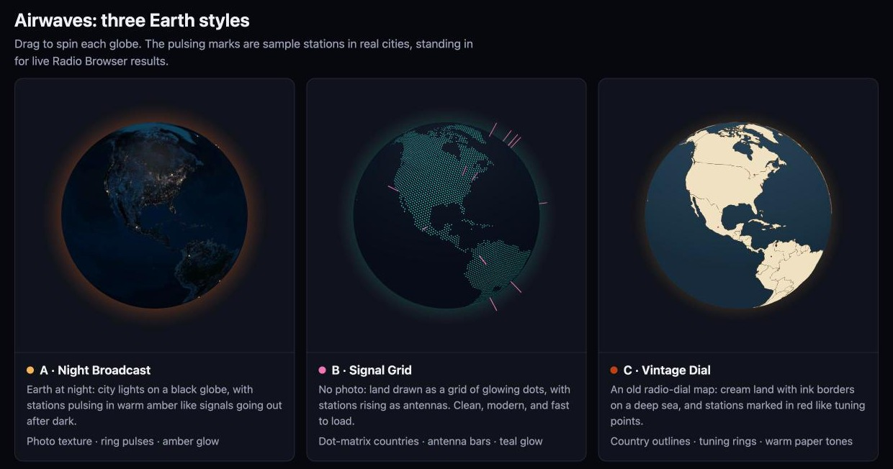
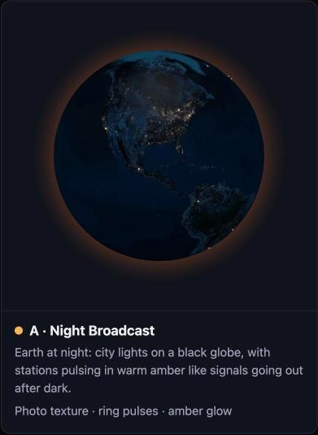
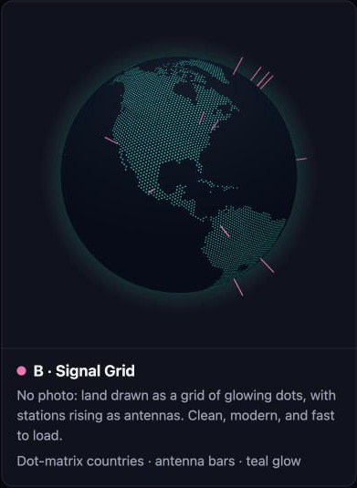
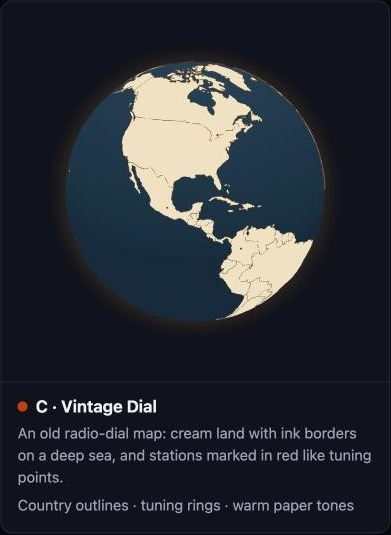

# Globe style mockups

Before redesigning the globe, I had three Earth styles mocked up side by side so I could compare them. Open `globe-styles.html` (or the [live version](https://airwaves-five.vercel.app/mockups/globe-styles.html)) to spin them yourself.

| Mockup | What happened to it |
|---|---|
| **A · Night Broadcast** | Became the app's default **Day & Night** style. Instead of always showing night, it now blends a daytime photo with the city lights based on where the sun really is. |
| **B · Signal Grid** | Dropped. The dot grid kept losing narrow islands such as Japan, even at a finer resolution, so I cut it rather than ship a map with holes. |
| **C · Vintage Dial** | Kept, almost unchanged, as the second style. |

| A · Night Broadcast | B · Signal Grid | C · Vintage Dial |
|---|---|---|
|  |  |  |
